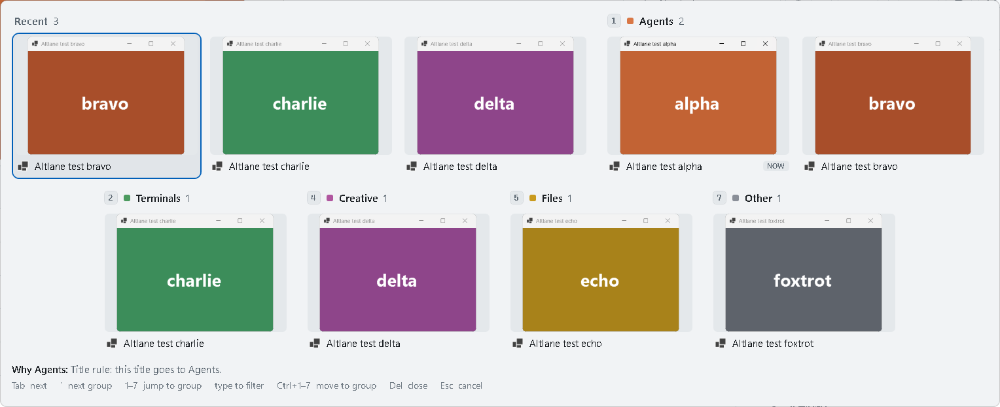
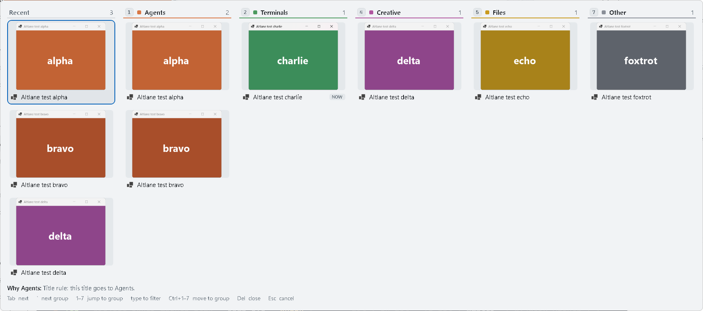

# Altlane

Alt+Tab and Win+Tab for Windows 11, grouped by the kind of window.



Windows' Alt+Tab shows every open window in one long row. Altlane keeps your three most recent windows
in a Recent row and sorts the rest into seven numbered groups that always sit in the same order:
Agents, Terminals, Web, Creative, Files, Docs & notes, Other. Your hand learns that terminals are 2
and the browser is 3. A quick Alt+Tab still flips straight back to your last window without drawing
anything.

Alt+Tab comes in two layouts, picked in Settings: a grid, where the groups wrap into rows (above), or
columns, one per group side by side (below). Both show the same windows in the same order.



Win+Tab opens the lanes overview: every group in its own lane, full screen, with a search box on top.
It stays open after you let go of Win, until you press Enter, click a window or press Esc. Shift+Win+Tab
still opens Windows' Task View, and Settings can give Win+Tab back to Task View altogether.


## Install

Download `Altlane-Setup-0.3.0.exe` from [Releases](https://github.com/drknowhow/altlane/releases) and
run it. It installs for your user only, so there is no admin prompt, and offers to start Altlane when
you sign in. It needs the [.NET 10 Desktop Runtime](https://dotnet.microsoft.com/download/dotnet/10.0)
(x64) and offers the download page if that's missing.

The installer isn't code-signed yet, so Windows SmartScreen warns the first time: choose "More info",
then "Run anyway".

Altlane runs in the tray: Pause, Settings, Open rules, Open log folder, Quit. Ctrl+Alt+Shift+Q quits it
from anywhere.

## Keys

| Keys | What happens |
|---|---|
| Alt+Tab, quick tap | Straight back to the previous window; nothing is drawn |
| Alt+Tab, held | Recent (the 3 windows after the current one), then groups 1–7 |
| Tab / Shift+Tab | Next / previous window |
| ` / Shift+` | First window of the next / previous section (` is the key above Tab) |
| Arrows, grid | ← → next / previous window; ↓ ↑ next / previous section |
| Arrows, columns | ↓ ↑ up and down the column; ← → the next / previous column, at the same row |
| 1–9 (Alt held) | First window of that group |
| Letters, Space | Filter by title, app or group name; the view stays open after Alt is released, Enter switches |
| Esc | Clears the filter, or closes the view |
| Del | Closes the selected window |
| Ctrl+1–9 (Alt held) | Moves the selected window to that group |
| Alt+` | Like Alt+Tab, but only the current window's group; Tab widens to every window |
| Alt+1–9 | Off by default, since some apps use Alt+number. When on: the most recent window in that group |

In the Win+Tab overview nothing needs to be held down:

| Keys | What happens |
|---|---|
| Win+Tab | Opens the overview on the previous window, so Enter goes straight back to it |
| Tab, `, 1–7, arrows | Move as in the columns layout |
| Letters, Space | Search by title, app or group name; Backspace edits, Esc clears |
| Mouse | Pointing at a window selects it, clicking switches to it, clicking anywhere else closes the overview |
| Enter | Switches to the selected window |
| Esc, Win+Tab | Closes the overview |
| Ctrl+1–7, Del | Move the selected window to a group, or close it, as in Alt+Tab |
| Shift+Win+Tab | Windows' Task View, with its virtual desktops |

## Groups and rules

| # | Group | Out of the box |
|---|---|---|
| 1 | Agents | Claude, ChatGPT, and a terminal running a Claude Code session |
| 2 | Terminals | Windows Terminal, PowerShell, cmd |
| 3 | Web | Browser windows that no site rule claims |
| 4 | Creative | Blender, FreeCAD, Shotcut, and sites such as Suno and Google Flow |
| 5 | Files | File Explorer |
| 6 | Docs & notes | Notepad, Word, Excel, PDF readers |
| 7 | Other | Everything else |

The rules live in `%LOCALAPPDATA%\Altlane\rules.json` (tray → Open rules), and Altlane reloads the
file when you save it. A rule matches a window by its program, its title, an installed web app, or a
site in a browser tab; the first match wins and anything unmatched goes to Other. The footer of the
view says which rule placed the selected window.

Ctrl+number on a window that got its group from its program saves a rule for that program. A window
placed by its title or a browser tab moves alone, until it closes.

## Admin windows

While an app running as administrator is in front, Windows doesn't pass keys to programs running at
normal rights, so Windows' own Alt+Tab and Task View appear there. Settings → "Turn on admin mode…"
adds a scheduled task that starts Altlane as administrator when you sign in. It asks for permission
once, and uninstalling removes the task.

## Privacy

- Altlane makes no network connections.
- It watches the keyboard to catch Alt+Tab and Win+Tab. Keys outside an open switcher pass straight
  through and are not recorded.
- Its logs, in `%LOCALAPPDATA%\Altlane\logs`, hold timings, program names such as `chrome.exe` and
  settings changes. They never hold window titles or anything you type. Uninstalling offers to delete
  them along with your rules.

## Building and testing

Requires the .NET 10 SDK, and [Inno Setup 6](https://jrsoftware.org/isinfo.php) for the installer.

```
dotnet build src/Altlane -c Release
dotnet build test/Altlane.SelfTest -c Release
powershell -File tools/build-installer.ps1
```

`build-installer.ps1` publishes the app to `dist\publish` and writes `dist\Altlane-Setup-<version>.exe`.
The version is `<Version>` in `src/Altlane/Altlane.csproj`.

`test/Altlane.SelfTest/bin/Release/net10.0-windows/Altlane.SelfTest.exe`:

- `unit`: rule order, saving rules, and the section, filter and navigation logic. No windows.
- `selftest`: starts `Altlane.exe --test` with its own rules and six test windows, drives it with
  injected keys and mouse moves, and writes `summary.json` and screenshots to `logs/selftest-<time>`.
  Don't touch the keyboard or mouse while it runs: it waits for 8 s with no input, stops at the first
  real input, and won't run with an admin window in front or beside a running Altlane.
- `startprobe`: tries each way of switching windows while Start is open.
- `testwindows`: the six "Altlane test …" windows on their own.

How it was tested and what testing found: [docs/phase1.md](docs/phase1.md) for Alt+Tab,
[docs/phase2.md](docs/phase2.md) for Win+Tab, and for the first prototype, [docs/spike.md](docs/spike.md).

## License

MIT. See [LICENSE](LICENSE).

Altlane is an independent project, not affiliated with or endorsed by Microsoft. Windows is a trademark
of Microsoft Corporation; other product names belong to their owners.
