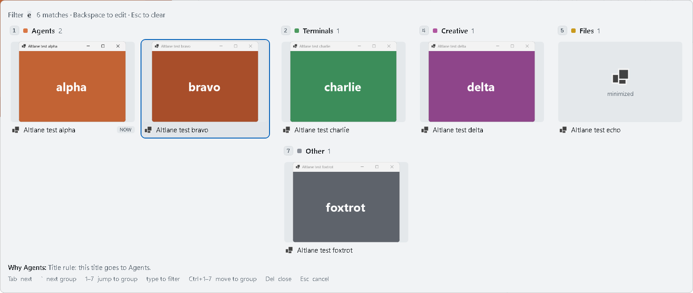
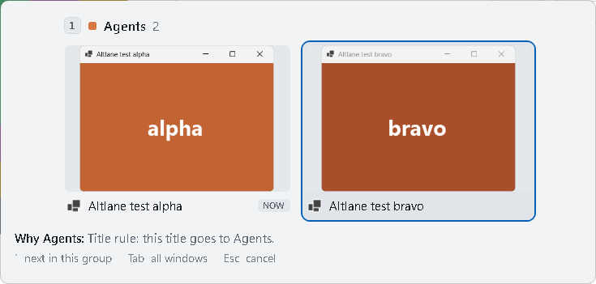
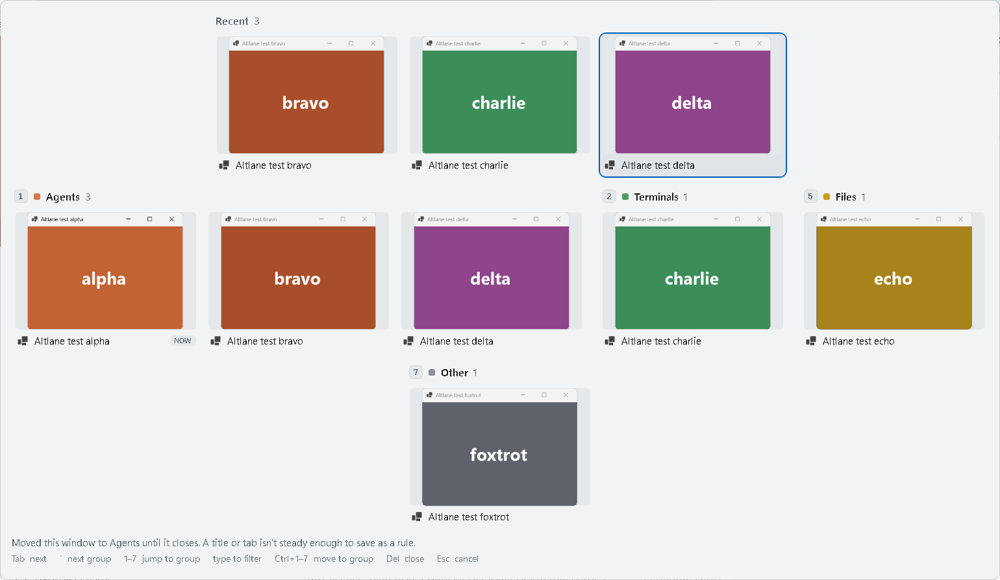

# Phase 1: findings

Date: 2026-10-23. Machine: Windows 11 Home 10.0.26300, .NET 10.0.6, one monitor at 1536×864 (125%),
light app theme, non-elevated.

## What phase 1 is

Altlane 0.1.0: Alt+Tab in layout A, a tray app, a rules file, and a per-user installer. Win+Tab is
not touched: it still opens Windows' Task View. The lanes overview (layout C) is phase 2.

| Keys | What happens |
|---|---|
| Alt+Tab, quick tap | Straight back to the previous window; nothing is drawn |
| Alt+Tab, held | Layout A: Recent (the 3 windows after the current one), then groups 1–7 |
| Tab / Shift+Tab, ← → | Next / previous card |
| `, ↓ / Shift+`, ↑ | First card of the next / previous section |
| 1–9 (Alt held) | First card of that group; an empty group says so in the footer |
| Letters, Space | Filter by title, app or group name. The view stays open after Alt is released; Enter switches |
| Esc | Clears the filter, or closes the view |
| Del | Closes the selected window, the same as its close button |
| Ctrl+1–9 (Alt held) | Moves the selected window to that group (see below) |
| Alt+` | Like Alt+Tab, but only the current window's group. Tab widens to every window |
| Alt+1–9 | Off by default (apps use Alt+number). When on: the most recent window in that group |
| Ctrl+Alt+Shift+Q | Quits Altlane, even when paused |

Ctrl+number saves a rule when the window got its group from its app: `"notepad.exe": "docs"` goes
into `rules.json`, or the installed web app's id goes into `webApps`. A window placed by a title rule
or a browser tab moves alone, and only until it closes: titles change, so there is nothing steady to
save as a rule.

The rules live in `%LOCALAPPDATA%\Altlane\rules.json`. Altlane reloads the file when it is saved. A
file with an error keeps the last good rules, and the tray says so once. The footer explains every
placement ("Why Agents: The title starts with the mark Claude Code puts on its terminal…").

## How it was tested

- **Unit checks:** `Altlane.SelfTest.exe unit`, 59 checks of rule order, saving rules, and the
  section, filter and navigation logic. 59 of 59 passed.
- **Self-test:** `Altlane.SelfTest.exe selftest` runs the real `Altlane.exe --test` against six
  test windows with its own rules, and drives it with keys injected through `SendInput`. Each step
  checks three things against the driver's own model of recency and groups: which window ends up in
  front, the section and index of the card Altlane says it switched to, and the exact sections and
  windows of the view Altlane logged. It keeps the spike's safety rules (waits for 8 s idle, stops at
  the first real input, refuses an elevated window in front, refuses to run beside a running Altlane)
  and adds one more: it stops before any key would land in a window it didn't open.
- **Admin task:** `Altlane.exe --admin-task selfcheck` registers the scheduled task at normal rights
  with a harmless action, runs it, and deletes it. Passed; no task left behind.
- **Installer:** a silent install into a scratch folder with "Start when I sign in" on, then a silent
  uninstall. Install wrote the files, the Run value (pointing at the installed exe), the Start menu
  shortcut and the uninstall entry. Uninstall removed all four.

## Results (0.1.1, last self-test run)

Verdict **GO**: every criterion passed. 0.1.0's run 3 was also GO, without T12; its numbers were within
a few milliseconds of these.

| Test | What it checks | Result |
|---|---|---|
| T1 quick tap | Alt+Tab tap lands on the previous window | 10/10 |
| T2 hold and cycle | k Tabs land on the k-th card; the view matches the model exactly | 10/10 |
| T3 group keys | 4, 7, an empty group, `, Shift+`, ←, →, ↓, ↑ | 9/9 |
| T4 filter | "ech", "fox", "files" onto minimized windows; never selects the current window | 3/3 |
| T5 Esc | Cancels; with a filter, the first Esc clears it | 5/5 |
| T6 Alt+` | Toggles within a group; a group of one says so; Tab widens | 7/7 |
| T7 Alt+number | Jumps by group, skips the current window; empty group says so | 4/4 |
| T8 Ctrl+number | Title-rule window moves alone and rules.json is untouched; unruled window saves an app rule | 2/2 |
| T9 Del | Closes the window; the view drops it | 1/1 |
| T10 watchdog | Hook removed the way Windows does it; the watchdog puts it back; Alt+Tab works after | 2/2 |
| T11 Win+Tab | Still opens Windows' Task View, with no Altlane overlay | 2/2 |
| T12 Start open | Opens Start, then a quick tap or a held Alt+Tab; Start closes and the switch lands | 4/4 |
| Controls | A stray key leaks, a lone Alt opens the menu, a lone Win opens Start | all caught |

| Measure | Result |
|---|---|
| Windows' own switcher appearing (T1–T10) | Never |
| Menu bar after Alt release | 0 |
| Keys reaching the test windows | 0 |
| Switches landing | 45 of 45: 41 with plain `SetForegroundWindow`, 4 (T12) with Esc to Start first |
| Time to switch (last key to window in front) | p50 2.6 ms, p95 8.0 ms, max 17 ms (the slowest are T12's, which wait for Start to close) |
| Overlay on screen (from "show" to composed) | p50 21 ms, p95 35 ms, max 40 ms, 52 shows. Target 50 ms |
| Keyboard hook callback | p50 1.5 µs, p99 3.0 ms, max 4.0 ms |
| Watchdog | Reinstalled the hook 31 ms after the first key it missed |

The first show of the run is no longer the slow one: warming the overlay with the real sections and
thumbnails at startup fixed the spike's 47–70 ms first show.

## What testing found

- Altlane said "ready" before its message loop ran, so the off-screen warm-up was still visible.
  Run 1 stopped on its own check. It now says ready after the warm-up is hidden.
- Typing a filter selected the window already in front, so Enter went nowhere. The selection now skips
  the current window, as Alt+Tab's first selection already did. T4 checks every filtered view for it.
- The lone-Win control left Start holding the foreground, and the next step couldn't take it back
  (run 2). The controls now run last and wait for Start to close.
- Found in review, not by a test: Shift+` or Ctrl+number inside the view could switch the keyboard
  layout, because Windows never sees the key Altlane swallows. The hook now sends its mask key in
  those cases.
- A copy run from a build folder would have turned on start at sign-in pointing at that folder. Only
  the installer and the Settings checkbox set it now.

## After real use (0.1.1)

0.1.0 then ran on a real keyboard for about 9 minutes: 22 switches, 19 landed. All three failures
happened with the shell in front: twice Start, once Explorer (the taskbar or a shell menu; the log
didn't say which).

`Altlane.SelfTest.exe startprobe` opens Start, then tries each way of bringing a window forward:

| With in front | Plain `SetForegroundWindow` | Altlane 0.1.0's full fallback chain | Esc first, then either |
|---|---|---|---|
| Start | 0 of 3 | 0 of 3 | 6 of 6, about 16 ms |
| The taskbar (Win+T) | 2 of 2 | 2 of 2 | 4 of 4 |

With Start open, Windows refused every method 0.1.0 had. Closing Start first, as Windows' own Alt+Tab
does, worked every time. 0.1.1 sends Esc before switching when Start, Search, another shell surface or
an open menu is in front, and never while Alt is still held, because Alt+Esc sends the front window to
the back. Failed switches now also log the front window's class and menu state, so the next Explorer
failure will say what was open.

A new self-test, T12, opens Start before each Alt+Tab. Its first runs found three more problems, each
fixed in 0.1.1:

- On a quick tap, Altlane switches before Windows has processed the Alt-up, and Start ignored an Esc
  sent that early. Altlane now waits for Windows' key state to show Alt released (2–15 ms, at most
  50 ms) before it sends Esc.
- Start closing leaves no window in front for a few milliseconds. A switch made in that gap was undone
  when Windows gave the foreground back to the window behind Start. Altlane now waits for a window to
  take the foreground first.
- With no Altlane window on screen, Windows 11 ignores its request for a 1 ms timer, so each 2 ms wait
  while confirming a switch took a 15.6 ms tick: switches took 15 ms instead of 2.5 ms. Altlane now
  opts out of that, with the documented `PROCESS_POWER_THROTTLING_IGNORE_TIMER_RESOLUTION`.

Version 0.1.1 is also the first under the name Altlane; phase 1 ran as Altitude.

## What phase 1 did not prove

- **Real keyboard.** Every self-test key was injected. Real use covered only the 9 minutes above.
- **Admin windows.** With an admin window in front, a non-elevated hook sees nothing, so Windows'
  Alt+Tab appears. Admin mode (Settings → Admin windows → "Turn on admin mode…", a scheduled task that
  starts Altlane elevated at sign-in) is built but was only checked through the self-check. Turning it
  on for real needs one UAC prompt.
- **The installer around a running copy.** The upgrade path (`Altlane.exe --quit` before replacing
  files), the missing-runtime message, and uninstall removing a real admin task were not exercised.
- **Scale and screens.** Six windows, one monitor, one DPI, light theme. The dark theme, 40+ windows,
  several monitors and mixed DPI are untested.
- **A hook Windows removes.** The watchdog notices on the first key after the hook is gone, so that
  one key, if it is an Alt+Tab, gets Windows' switcher.

## Manual check

1. Run `dist\Altlane-Setup-0.1.1.exe`. Leave "Start Altlane when I sign in" ticked. No admin
   prompt should appear. Altlane starts in the tray.
2. Use Alt+Tab on your real windows: a quick tap, holding and Tab, a number key, typing a few letters
   then Enter, Esc. Check that each window sits in the group you'd expect; the footer says why.
3. Hold Alt+Tab on a window in the wrong group and press Ctrl plus the right number. Check
   `rules.json` (tray → Open rules) for the new line.
4. Click into an admin window (an admin PowerShell) and press Alt+Tab. Expected: Windows' own switcher.
5. Optional: Settings → "Turn on admin mode…", accept the prompt, and repeat step 4. Expected:
   Altlane.
6. Sign out and back in. Altlane should be in the tray (from the Run key, or from the task in admin
   mode).
