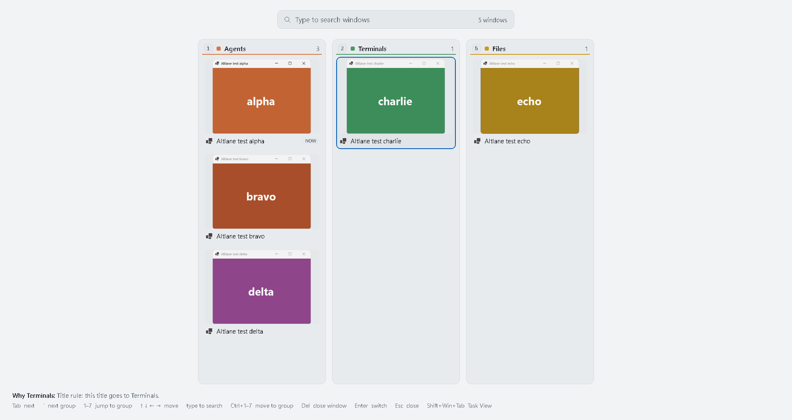

# Phase 2: Win+Tab

Date: 2026-10-23. Machine: Windows 11 Home 10.0.26300, .NET 10.0.6, one monitor at 1536×864 (125%),
light app theme, non-elevated.

## What phase 2 is

Altlane 0.3.0 gives Win+Tab the lanes overview: every group in its own lane, filling the work area of
the monitor under the mouse, with a search box on top and the Why line and key hints at the bottom.
The taskbar stays visible. The build follows a clickable mock that was approved first.

- **No Recent row.** Each window appears once, in its group. The lanes are the same columns as Alt+Tab's
  columns layout (`Layouts.Columns`), with a wider gap so each lane can have its own box.
- **It opens on the previous window**, so Win+Tab then Enter goes back to it, like a quick Alt+Tab.
- **Nothing has to be held.** The overview stays open after Win is released, until Enter, a click on a
  window, Esc, a click anywhere outside a window card, or Win+Tab again.
- **Keys work as in the columns layout:** Tab and Shift+Tab, ` and Shift+`, 1–7, ↓ ↑ within a lane and
  ← → across lanes, Ctrl+1–7 to move a window to a group, Del to close it. Typing searches; Backspace
  edits the search and the first Esc clears it.
- **The mouse:** pointing at a card selects it, clicking it switches. Only real movement selects: when
  the overview opens or redraws under a still cursor, the card under it is not selected.
- **Task View is one key away.** Shift+Win+Tab opens Windows' Task View, from the overview or without
  it. Settings, Switching, "Win+Tab" picks "Lanes overview" (the default) or "Windows' Task View".
- **No virtual desktops strip.** Windows has no supported API to list or switch desktops, so the
  overview shows this desktop's windows only, as Alt+Tab does. Task View remains the way to desktops.

## How the keyboard hook handles it

Win+Tab arrives at the hook with Win already down, and Windows has seen that Win-down. The hook
swallows the Tab and sends its mask key, so releasing Win doesn't open Start. Shift+Win+Tab releases
Shift as far as Windows knows and replays a plain Win+Tab with Altlane's marker, which the hook lets
through, so Task View opens; this is the phase 0 spike's method.

While the overview is open the hook takes every key, as it does for a typed Alt+Tab filter. That
filter gives up after 30 s in case the UI has hung. The overview can stay open as long as you like,
so instead the UI acknowledges each event as it handles it, and the hook ends the session when an
event has gone unanswered for 3 s.

## How it was tested

- **Unit checks:** `Altlane.SelfTest.exe unit`, now 79 checks. New ones: the overview's sections have
  no Recent row and list each window once, in group order; and `Layouts.Lanes` at 1536×816 DIPs for
  eight groups of one, a group of twelve and six mixed groups: every lane inside the work area, under
  the search box and above the footer, the lanes apart, every card inside its lane, the lanes centered,
  and a group too tall for its lane continuing in a second column inside it. 79 of 79 passed.
- **Self-test:** T11 used to check that Win+Tab still opened Task View. It now tests the overview,
  against the real `Altlane.exe --test` and the six test windows, with keys and mouse moves injected
  through `SendInput`, so the guard that stops at the first real input still works. Each overview step
  checks that the overview is open after Win is up and Start is not, that the first view is exactly the
  driver's model (groups only, most recent first) and opens on the previous window, and then which
  window ends up in front and which card Altlane says it switched to.
- **Task View:** four rows check that Task View still opens, with no overview and no Start: Shift+Win+Tab
  on its own, Shift+Win+Tab with the overview open (which must also close it), and twice Win+Tab with
  the setting switched to Task View through a test-only control message (`Altlane.Test.WinTab`, not
  saved to `settings.json`).
- The rest of the self-test (T1–T10, T12, T13 and the controls) ran unchanged, so Alt+Tab was checked
  again against the new hook.

## Results (0.3.0, logs/selftest-p2-run2)

Verdict **GO**: every criterion passed.

| Test | What it checks | Result |
|---|---|---|
| T11 keys | Enter right away goes back; Tab, →, ← ↓, → → ↓ ↓ (wraps), ↓ at the foot of a lane, `, 5, 1 ↓ ↓ ↓ ↑ | 9/9 |
| T11 search | Typing "ech" leaves only echo; Enter switches to it | 1/1 |
| T11 closing | Esc; Esc with a search typed (the first clears it); Win+Tab again | 3/3 |
| T11 mouse | Pointing at a card then Enter; clicking a card; clicking outside the cards | 3/3 |
| T11 Task View | Shift+Win+Tab, from nothing and from the overview; Win+Tab with the setting off, twice | 4/4 |
| T1–T10, T12, T13 | Alt+Tab, as in 0.2.0 | 65/65 |
| Controls | A stray key leaks, a lone Alt opens the menu, a lone Win opens Start | all caught |

In every T11 step the overview was open after Win was released and Start was not, the first view was
exactly the model's (`agents:alpha,bravo,delta term:charlie files:echo`) and opened on the previous
window, and none of the key-only steps selected a card under the still cursor.

| Measure | Result |
|---|---|
| Windows' own switcher appearing (T1–T11) | Never, outside the Task View rows |
| Menu bar, keys reaching the test windows | 0, 0 |
| Switches landing | 65 of 65; p50 2.4 ms, p95 6.9 ms, max 13.6 ms |
| Overview on screen (from "show" to composed) | p50 20 ms, p95 28 ms, max 29 ms, 23 shows. Target 100 ms |
| Win+Tab to the overview composed | p50 26 ms, max 31 ms, 17 overviews |
| Alt+Tab view on screen | p50 25 ms, p95 37 ms, max 42 ms, 60 shows. Target 50 ms |
| Keyboard hook callback | p50 1.2 µs, p99 3.0 ms, max 5.9 ms |

The overview drew faster than Alt+Tab's view here, though it fills the screen. It had fewer cards to
draw: five, against up to nine with the Recent row.

## What testing found

- Run 1 was NO-GO on one row: Shift+Win+Tab with the overview open did open Task View and close the
  overview, but the log said the overview closed because the foreground changed, not because of
  Shift+Win+Tab. Task View can take the foreground before Altlane handles the hook's event, and either
  one closes the overview, so the order isn't fixed. The check now accepts either reason; run 2 was GO.
- A unit check expected six small groups to get full-size cards at 1536×816. They don't: a group of
  five is taller than its lane, continues in a second column, and the cards shrink to 182 DIPs to keep
  every lane on screen. The check was wrong, not the layout; it now checks that second column.

## Not covered

- More than one monitor: the overview opens on the monitor under the mouse, as Alt+Tab does, but this
  PC has one.
- An admin window in front: Altlane at normal rights doesn't see the keys then, so Windows' Task View
  opens instead. Alt+Tab has the same limit, and admin mode covers both.
- Touch and pen, and dark mode (the lane colours are set for both themes; only light was on screen).
- Real use on a real keyboard.
