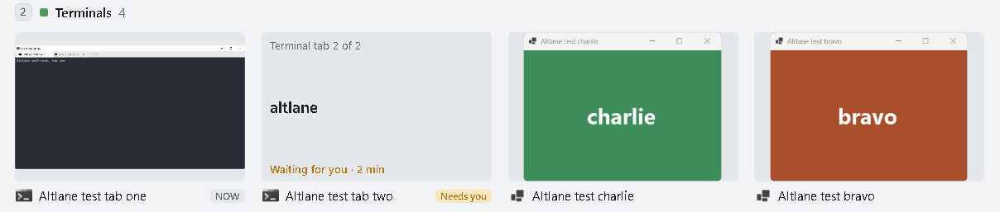

# Phase 3: terminal tabs, Claude Code, the mouse, usage

Date: 2026-10-24. Machine: Windows 11 Home 10.0.26300, .NET 10.0.6, one monitor at 1536×864 (125%),
light app theme, non-elevated.

## What 0.4.0 is

Altlane 0.4.0 adds five things. The build follows a clickable mock of the new cards, pills and
settings.

- **A card per terminal tab.** Altlane reads Windows Terminal's tab names through UI Automation, on a
  worker thread, when a view opens and every 5 seconds. The tab in front gets the live picture;
  Windows doesn't draw the others, so their cards show the tab's name instead. Choosing a tab's card
  brings up that tab, Del closes only that tab, and Ctrl+number moves it to another group until it
  closes. Settings can turn this off, and a terminal window is then one card again.
- **Claude Code marks.** Claude Code keeps a status file per running session in
  `%USERPROFILE%\.claude\sessions\<pid>.json`. Altlane reads the files whose process is still running
  and was started from the command line, and matches a session to the tab whose title is the session's
  name. "waiting" becomes a "Needs you" pill, "busy" a "Working" pill, and the Why line says how long
  the session has waited. Sessions from the desktop app or an SDK have no tab and are left out. An
  option lists waiting sessions first in their group. Newer Claude Code versions put ◐ or ◑ in front
  of a working session's title (✳ when idle), so the Claude Code rule now matches those too, and an
  older `rules.json` is upgraded when 0.4.0 starts.
- **The mouse.** Pointing at a card selects it in Alt+Tab too (a setting), a middle click closes a
  window or tab, and dragging a card onto another group moves it there, as Ctrl+number does. While
  dragging, a copy of the card follows the pointer. It is a WPF popup, a separate window, because the
  live pictures are drawn by Windows above everything inside the overlay's own window.
- **Usage.** Each switch's log line now says how the window was picked (a quick tap, Tab, `, arrows,
  a number, the mouse, a search, or the first card) and counts the keys used to get there. Tray →
  Usage… reads 7 days of logs and shows switches, times, picks, groups, and features not used yet. The
  logs still hold no titles and nothing typed.
- **Speed and trust.** Cards are kept between views and reused when nothing about them changed, and
  Alt+Tab's cards are built in the background shortly after the window in front changes. On another
  monitor the views are centred on that monitor's work area, and re-centred if the move changed the
  window's DPI. `tools/build-installer.ps1` can sign the app, the setup and the uninstaller, and
  `tools/winget-manifest.ps1` writes and validates winget manifests. Neither has been used for a
  release yet: signing needs a certificate, and a winget submission is a public pull request.

## How it was tested

- **Unit checks:** `Altlane.SelfTest.exe unit`, now 118 checks (79 in 0.3.0). New ones: tab cards in
  the grid, columns and lanes layouts get a slot each; Claude Code status files (a dead process, a
  desktop-app session, a name that matches no tab); the rule upgrade; usage counts from sample log
  lines; and where a view goes on fake monitors, one at 150% left of the primary and one above it.
- **Self-test:** four new phases against the real `Altlane.exe --test`, with keys and mouse moves
  injected through `SendInput`.
  - T14: pointing at a card in Alt+Tab selects it and releasing Alt switches to it; then a quick tap,
    Tab and a number key, each checked against the `pick` the log records.
  - T15: in the overview, dragging a card onto the Terminals lane moves it there (a screenshot is
    taken mid-drag), and a middle click closes a window.
  - T16: a real Windows Terminal window with two tabs, and a status file in a test sessions folder
    saying tab two's session is waiting. Both tabs get a card, tab two's says "Needs you", choosing it
    brings up tab two, and Del on a tab's card closes only that tab.
  - T17: a second process opens 30 more windows spread over the groups, then Alt+Tab opens 12 times
    and Win+Tab 6 times. Every open must show a card per window, and the busy desktop's times are
    reported apart from the six-window phases.
- The rest of the self-test (T1–T13 and the controls) ran unchanged.
- The whole self-test ran again with Altlane's theme set to dark (`--theme dark`).

## Results (0.4.0, logs/selftest-040-light-try2)

Verdict **GO**: every criterion passed.

| Test | What it checks | Result |
|---|---|---|
| T14 | Pointing selects in Alt+Tab and releasing Alt switches; a quick tap, Tab and a number key logged as such | 4/4 |
| T15 | Dragging a card onto the Terminals lane; a middle click closing a window | 2/2 |
| T16 | Two Windows Terminal tabs as two cards, "Needs you" on tab two, choosing it, Del closing one tab | 3/3 |
| T17 | 30 more windows: 12 Alt+Tab and 6 Win+Tab opens, each with a card per window | 2/2 |
| T11 | Win+Tab's overview and Task View, as in 0.3.0 | 20/20 |
| T1–T10, T12, T13 | Alt+Tab, as in 0.3.0 | 65/65 |
| Controls | A stray key leaks, a lone Alt opens the menu, a lone Win opens Start | all caught |

| Measure | Result |
|---|---|
| Windows' own switcher appearing, menu bar, keys reaching the test windows | Never, 0, 0 |
| Switches landing | 70 of 70; p50 2.4 ms, p95 6.4 ms, max 15.9 ms |
| Alt+Tab view on screen | p50 19 ms, p95 31 ms, max 34 ms, 68 shows. Target 50 ms |
| Overview on screen | p50 18 ms, p95 28 ms, max 42 ms, 27 shows. Target 100 ms |
| Busy desktop, Alt+Tab (37 cards) | p50 32 ms, slowest 40 ms, 12 opens. Target 50 ms |
| Busy desktop, Win+Tab (34 cards) | p50 30 ms, slowest 61 ms (the first open, which built every card), 6 opens. Target 100 ms |
| Keyboard hook callback | p50 1.1 µs, p99 2.9 ms, max 4.8 ms |
| Garbage collections during a show | 4 in 113 shows, 9.6 ms in all |

The whole self-test also ran with Altlane's theme set to dark (logs/selftest-040-dark-try1). Every
test row passed, and the screenshots of the tab cards, the "Needs you" pill and a drag look right in
dark. One criterion failed there: the busy desktop's first Alt+Tab took 75 ms, so the p95 of its 12
opens was 75 ms against the 50 ms target. The other eleven took 23–35 ms. See below.

Getting a clean run took several tries. Other programs on this PC kept bringing their windows to the
front during runs (Notepad, Chrome, and an Explorer frame window), with nobody at the keyboard. Each
time, the self-test's guard stopped the run before a key could reach a window it hadn't opened. The
script that starts the self-test now waits for 5 minutes with no input and 2 minutes with the same
window in front, and retries a run that was stopped this way.

## What testing found

- Run 1 failed T16: the second tab's card couldn't be hovered or picked. The layouts built card slots
  from the window alone, so two tabs of one window shared a slot, and the overlay looks cards up by
  slot. Slots now include the tab, and unit checks cover two tabs of one window in each layout.
- Reusing cards first saved almost nothing: layout still took 6–13 ms on a busy desktop. The window
  sets `UseLayoutRounding` and the text formatting mode for everything inside it; a card taken out
  loses those inherited values and gets them back when it is put in again, and each change makes WPF
  measure the card again. Each card now sets them itself, and layout fell to 2.5–6 ms.
- With 30 more windows open, the first Alt+Tab took 56 ms against the 50 ms target: 39 new cards to
  build and measure, while later opens took 32 ms. Altlane now builds Alt+Tab's cards with the view
  hidden, 1.2 s after the window in front changes, at most once per burst of new windows. The first
  open then reused 34 of 39 cards, and the busy desktop's slowest Alt+Tab was 40 ms.
- The first busy Alt+Tab is still sometimes slow. It took 84 ms in one run and 75 ms in the dark
  run, although each time it reused 32 of 37 prebuilt cards; in both, WPF layout alone took 47–48 ms,
  against about 5 ms in the other opens. In the light GO run the same open took 40 ms. Each show now
  logs its garbage collections and the CPU cycles its thread used. For the 75 ms open: one collection
  of 2.6 ms, and 37 million cycles against about 19.5 million for the other opens. That is a few
  milliseconds of extra work, so most of the 40 ms extra was spent waiting, not computing. What it
  waits for inside layout is not known. Between switches Altlane has no visible window, and Windows 11
  may then run it at efficiency speed (EcoQoS); it now opts out of that, as it already did for timer
  throttling. That didn't remove the slow first open, and its effect alone was not measured.

## Not covered

- More than one monitor, and moving between monitors with different scaling: the placement is
  unit-checked with fake monitors only, since this PC has one.
- Signing: the script's signing path has not run with a real certificate.
- winget: the manifests pass `winget validate` but were not submitted.
- Real Claude Code sessions: T16 writes its own status file. Matching was not checked against live
  sessions during the run.
- Touch and pen, and real use on a real keyboard.
