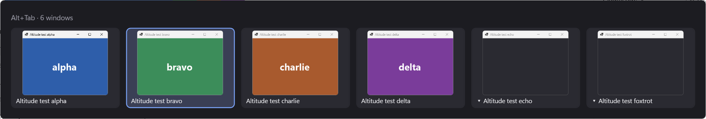
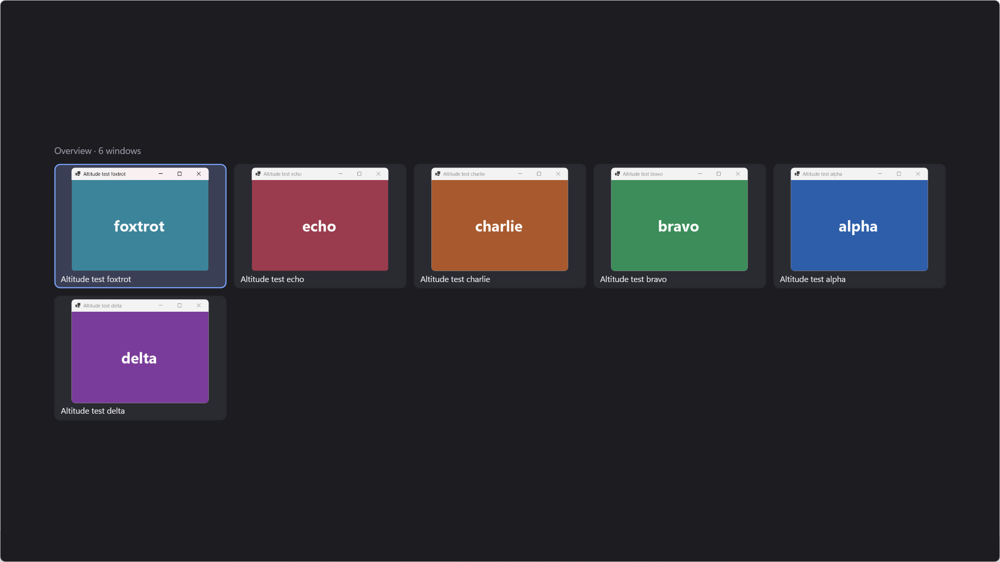

# Phase 0 spike: findings

The spike ran under the working name Altitude, which still shows in its two screenshots.

Date: 2026-10-23. Machine: Windows 11 Home 10.0.26300, .NET 10.0.6, non-elevated.

## What the spike had to prove

1. Alt+Tab and Win+Tab can be taken over without the menu bar (Alt release) or the Start menu
   (Win release) opening, and without the built-in switcher or Task View appearing.
2. The overlay is on screen within 50 ms of deciding to show it.
3. 50 of 50 switches land on the intended window, minimized windows included.
4. What happens with an elevated (admin) window in front.
5. Whether an existing switcher already groups windows by type.
6. Whether Shift+Win+Tab is free to keep the real Task View.

## Verdict

**Go for phase 1**, with two checks still needed on a real keyboard (see the manual check below).
Everything the automated test could reach passed in four complete runs.

## How it was tested

`Altlane.Spike.exe selftest` drives the switcher with keys injected through `SendInput` against six
test windows it opens itself, two of them minimized. Before starting it waits for 8 s with no keyboard
or mouse input. It stops at the first real key or mouse move and refuses to run with an elevated
window in front. Each test window logs any key that reaches it and any menu-bar activation.

The run ends with positive controls: a stray key, a lone Alt and a lone Win. In every run the detectors
caught all three (the key leaked, the window entered menu mode, Start opened). That is what makes the
zeros in the table mean something.

Five runs on 2026-10-23. Runs 1, 2, 3 and 5 completed. Run 4 aborted during setup (see below).
Logs are in `spike/logs/run*/`, which is not committed.

## Results

| Check | Target | Result (runs 1, 2, 3, 5) |
|---|---|---|
| Alt+Tab taken over | Windows' switcher never appears | Never appeared in 40 taps and holds per run |
| Alt released after switching | No menu bar | 0 menu activations in every run |
| Win+Tab taken over | No Start menu, no Task View | 0 of 5 per run |
| Keys reaching other apps | None | 0 in every run |
| Overlay on screen | 50 ms | p50 16–18 ms, p95 24–26 ms. First show of a run: 47–70 ms. All later shows: 35 ms or less |
| Switches land | 50 of 50 | 50 of 50 in every run, minimized windows included |
| Time to switch | | p50 2.3–2.5 ms, p95 4.5–5.5 ms, from the last key to the window in front |
| Shift+Win+Tab | Real Task View | 2 of 2 per run; Esc returns to the previous window |
| Keyboard hook callback | Far below the ~1 s limit | p50 1.4–1.6 µs, p99 2.6–3.5 ms, max 5.2–6.1 ms |

The screenshots show the spike's plain grid with live DWM thumbnails, not the A or C layout.

### Notes on the numbers

- Overlay time runs from "show now" to the first frame after `DwmFlush`, so it can be off by about one
  60 Hz frame. It includes registering the live thumbnails. Measured from the Tab key, p50 is about
  142 ms, because a quick tap waits 120 ms before drawing anything.
- The slow first show happens because warming the window off-screen at startup isn't enough. Phase 1
  should warm it with a real tile and a thumbnail.
- All 52 activations per run (50 Alt+Tab switches and 2 Win+Tab commits) worked with plain
  `SetForegroundWindow`; the `AttachThreadInput` and Alt-key fallbacks never ran.
- Both commit strategies landed every time: S1 (let Alt-up through, then switch) 32/32 per run, and
  S2 (hold back Alt-up, switch, then release) 20/20. Phase 1 uses S1. It is simpler, and a stalled
  switcher can't leave Alt stuck down.
- The hook's slow tail is probably the mask-key `SendInput` inside the callback, about once per
  session. It was not measured separately.
- Windows' own surfaces, for later detection: Alt+Tab and Task View are both
  `XamlExplorerHostIslandWindow` windows in explorer.exe, titled "Task Switching" and "Task View".

### Run 4

Run 4 stopped at its first step, before the switcher was running: the test driver could not bring its
own test window to the front. Plain `SetForegroundWindow`, `AttachThreadInput` and the Alt trick all
failed within 550 ms. Runs 1–3, just before it, did the same step with plain `SetForegroundWindow` in
8–14 ms. Run 5 added a log of what was in front and could not reproduce the failure. In run 5 the
Claude app was in front, after 11.6 s of idle.

So Windows' foreground lock did block every method once, and the cause is unknown. It is not known
whether the switcher would have failed at that moment. Phase 1 needs a fallback that doesn't depend on
the foreground lock, and a log line whenever a switch doesn't land.

## What the spike did not prove

- **Real keyboard.** Every key was injected. The switcher treated injected keys as typing, but
  Windows' foreground rules may treat hardware keys differently.
- **Admin window in front.** This can't be automated: keys injected into an elevated window are
  dropped, and a UAC prompt can't be clicked through. Expected but unconfirmed: a hook in a
  non-elevated process doesn't see keys while an elevated window has focus, so Windows' own Alt+Tab
  appears. If confirmed, the options are starting Altlane elevated at logon through a scheduled task,
  or a signed build with `uiAccess` installed under Program Files.
- **Scale and screens.** Tested with six windows on the primary monitor only. Thumbnail cost with 40
  or more windows, multiple monitors and mixed DPI are phase 1 work.
- **Minimized windows** show an empty frame, because DWM keeps no live image of them. Phase 1 should
  draw the app icon there.

## Carry into phase 1

- Keep: the hook on its own thread; the vkE8 mask key; the marker on injected keys; S1 commit; a
  pre-created overlay that never takes focus and gets its keys from the hook.
- Add: a hook watchdog (Windows removes a slow hook without telling it), multi-monitor placement,
  icons for minimized windows, the full Alt+Tab eligibility rule (owner chains), and the grouping
  rules.
- Safety stays: while the Win+Tab overview or a typed filter is open, the hook takes every key until
  Enter or Esc, and the hook ends that on its own after 30 s even if the UI hangs. Ctrl+Alt+Shift+Q
  quits.

## Manual check

1. Run `spike\Altlane.Spike\bin\Release\net10.0-windows\Altlane.Spike.exe run --minutes 10` from a
   normal (non-admin) terminal. Use Alt+Tab, a quick Alt+Tab tap, typing to filter, Win+Tab and
   Shift+Win+Tab on your real windows. Ctrl+Alt+Shift+Q quits early.
2. While it runs, click into an admin window (for example an admin PowerShell) and press Alt+Tab.
   Expected: Windows' own switcher, not Altlane's.
3. Optional: run the same command from an admin terminal and repeat step 2. Expected: Altlane's
   overlay.

## Existing switchers

Searched 2026-10-23. None groups windows into user-defined categories.

| Tool | What it groups by | Notes |
|---|---|---|
| Alt-Tab Terminator (NTWind) | App only | "App Cloud" filters to one app; Alt+` cycles the current app. No custom rules. Last release seen: v6.5, Feb 2025. |
| Switcheroo | Nothing | Incremental search by title; `chr.`-style prefix filters by process name. |
| PowerToys Window Hopper | Current app | Alt+` cycles the focused app's windows. No categories. |
| PowerToys Window Walker | Nothing | Search across all windows by title and process. Grouping not confirmed. |
| Windows 11 built-in | Nothing | The Alt+Tab setting only controls whether Edge tabs show. |

Not checked: AltTaber and FlipSwitcher (Windows ports of the macOS AltTab), and snap-group behavior.
The search may have missed a niche tool; it found no evidence one exists.

## Shift+Win+Tab

Microsoft's current shortcut list
(https://support.microsoft.com/en-us/windows/keyboard-shortcuts-in-windows-dcc61a57-8ff0-cffe-9796-cb9706c75eec)
lists Win+Tab only. Neither Shift+Win+Tab nor Ctrl+Win+Tab is assigned, so Shift+Win+Tab is free
to mean "the real Task View".
